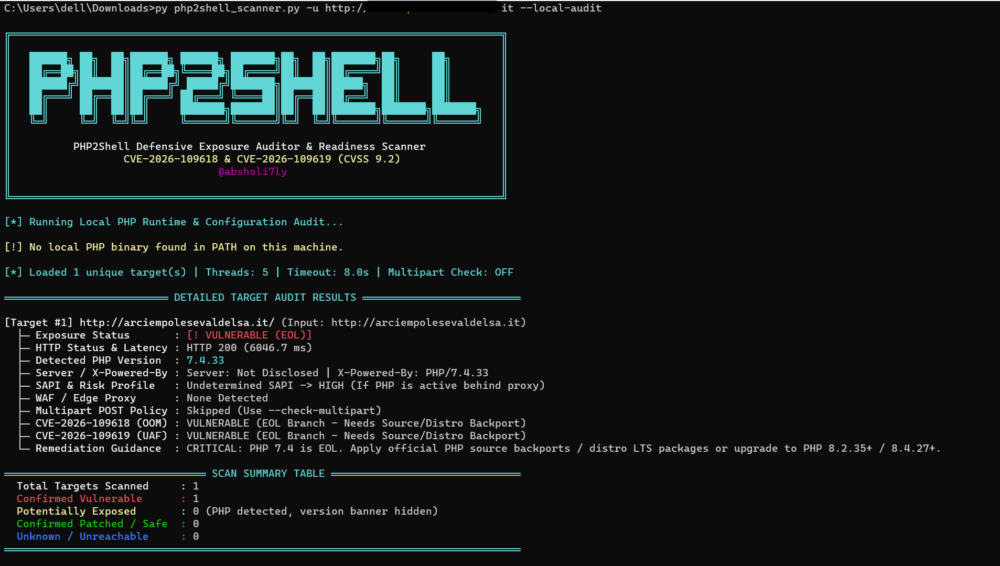

# Php2shell-Scanner

Designed to enable system administrators and incident response teams (SOC / CERT / DevOps) to scan servers and web applications whether a single target or a list of multiple targets to check for vulnerability to the "PHP2Shell" flaws, without sending any exploit payloads or causing memory crashes.

```text
╔══════════════════════════════════════════════════════════════════════════════╗
║                                                                              ║
║   ██████╗ ██╗  ██╗██████╗ ██████╗ ███████╗██╗  ██╗███████╗██╗     ██╗        ║
║   ██╔══██╗██║  ██║██╔══██╗╚════██╗██╔════╝██║  ██║██╔════╝██║     ██║        ║
║   ██████╔╝███████║██████╔╝ █████╔╝███████╗███████║█████╗  ██║     ██║        ║
║   ██╔═══╝ ██╔══██║██╔═══╝ ██╔═══╝ ╚════██║██╔══██║██╔══╝  ██║     ██║        ║
║   ██║     ██║  ██║██║     ███████╗███████║██║  ██║███████╗███████╗███████╗   ║
║   ╚═╝     ╚═╝  ╚═╝╚═╝     ╚══════╝╚══════╝╚═╝  ╚═╝╚══════╝╚══════╝╚══════╝   ║
║                                                                              ║
║          PHP2Shell Defensive Exposure Auditor & Readiness Scanner            ║
║                  CVE-2026-109618 & CVE-2026-109619 (CVSS 9.2)                ║
║                                 @absholi7ly                                  ║
║                                                                              ║
╚══════════════════════════════════════════════════════════════════════════════╝
```

## 3. Command-Line Arguments Reference

| Argument / Flag | Short / Long Syntax | Functional Description | Default Value |
| :--- | :--- | :--- | :--- |
| **Target URL(s)** | `-u URL [URL ...]` / `--url` | Scan one or more target URLs, bare domains, or `IP:Port` endpoints directly from the CLI (accepts space-separated or comma-separated lists). | Optional |
| **Target List File** | `-l FILE` / `--list FILE` | Path to a text file containing target URLs or domains (one target per line; lines starting with `#` are ignored). | Optional |
| **Local Server Audit** | `--local-audit` | Audit local PHP binaries in `PATH` and inspect effective `php.ini` settings (`memory_limit`, `session.upload_progress.enabled`, `fatal_error_backtraces`). | `False` |
| **Multipart Policy Check** | `--check-multipart` | Send a benign 1-field `multipart/form-data` POST request to test whether the web server or WAF blocks or accepts multipart uploads. | `False` |
| **Concurrency Threads** | `-t N` / `--threads N` | Number of concurrent worker threads when scanning multiple targets. | `5` |
| **Request Timeout** | `--timeout SEC` | Maximum HTTP connection/read timeout per request in seconds. | `8.0` |
| **Custom HTTP Header** | `-H 'Name: Value'` / `--header` | Append a custom HTTP header to all outbound requests (can be specified multiple times). | None |
| **HTTP/HTTPS Proxy** | `--proxy PROXY_URL` | Route outbound HTTP/HTTPS requests through an inspection proxy (e.g., `http://127.0.0.1:8080`). | None |
| **Strict SSL Verification** | `--verify-ssl` | Enforce strict TLS certificate chain and hostname verification (disabled by default to support internal IP/lab targets). | `False` |
| **Export Report File** | `-o FILE` / `--output FILE` | Export full scan results to an external file (`.json`, `.csv`, or `.md` based on extension). | None |
| **Disable ANSI Colors** | `--no-color` | Disable terminal ANSI color sequences for clean log redirection or CI/CD pipelines. | `False` |

## 4. Practical Usage Examples

### A. Scan a Single Target (Full URL or Bare Domain)
```bash
python php2shell_scanner.py -u https://example.com
```

### B. Scan Multiple Targets
```bash
python php2shell_scanner.py \
    -u 127.0.0.1:18426/audit_probe.php http://127.0.0.1:18427/audit_probe.php portal.example.org/login.php \
    --check-multipart
```

### C. Scan a Target List File with 15 Threads and Export to JSON, CSV, or Markdown
```bash
# Create a sample targets.txt file
cat << 'EOF' > targets.txt
# Production and Staging PHP Endpoints
https://store.example.com
http://127.0.0.1:18426/index.php
http://127.0.0.1:18427/index.php
api.example.net:8443/v1/upload.php
EOF

# Execute multi-threaded scan and export to JSON
python php2shell_scanner.py -l targets.txt -t 15 --check-multipart -o scan_report.json

# Or export as a Markdown table
python php2shell_scanner.py -l targets.txt -t 15 --check-multipart -o scan_report.md
```

### D. Perform a Direct Local Host Audit (`--local-audit`)
When `expose_php = Off` hides version headers over HTTP, run the tool directly on the server to audit all installed PHP binaries and INI directives:
```bash
python php2shell_scanner.py --local-audit
```


